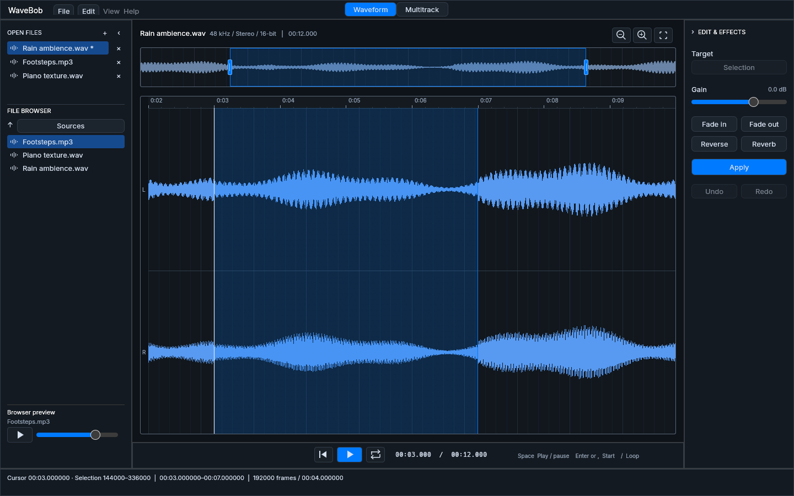

# WaveBob

A native audio editor built with Rust and egui, with waveform editing,
multitrack arranging, and a shared command interface for GUI, headless, and MCP workflows.



- Import WAV, MP3 and Ogg Vorbis, including drag-and-drop; export WAV and MP3.
- Cut, copy, paste, trim, apply gain, fades, reverse, and reverb, with undo/redo.
- Arrange clips across tracks with automatic crossfades, mixing, and audio export.
- Edit eleven live effect stacks in native windows, with nondestructive gain/fades.
- Share linked document bounces, preserve clip tails, and save portable editable projects.
- Automate edits and capture the running GUI through JSON commands or MCP.

## Build and run

Install [stable Rust](https://rustup.rs/) and your platform's native build tools:
MSVC C++ build tools and Windows SDK on Windows, Xcode command line tools on macOS,
or the following packages on Debian/Ubuntu:

```sh
sudo apt-get install build-essential pkg-config libx11-dev libxi-dev libxrandr-dev libxcursor-dev libxinerama-dev libwayland-dev libxkbcommon-dev libxkbcommon-x11-dev libgl1-mesa-dev libasound2-dev
```

```sh
git clone https://github.com/wilberton/WaveBob.git
cd WaveBob
cargo run --locked
```

Windows live-effects builds are verified locally. Earlier baseline release checks
passed on macOS/Linux; the latest effects changes have no further GitHub platform
runs under the requested local-test policy. See [final verification](docs/verification/live-effects-workflow/README.md).

## Automation and development

```sh
cargo run --locked --no-default-features --bin wavebob-headless
cargo run --locked --no-default-features --bin wavebob-mcp
```

See the [command protocol](docs/commands.md), [MCP setup](docs/mcp.md),
[automated editing workflow](docs/automation.md), and [build and packaging guide](docs/release.md).

```sh
cargo fmt --all --check
cargo clippy --locked --all-targets -- -D warnings
cargo test --locked --all-targets
```

## License

[GNU GPL v3](LICENSE). See [MP3 encoder notices](docs/mp3-encoder.md) and
[font licensing](assets/fonts/README.md) for bundled third-party components.
