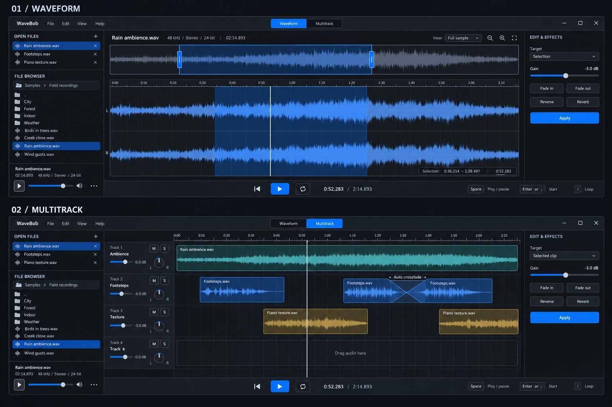

# WaveBob — concept 01

Status: visual direction accepted. The [published specification](../.scratch/wavebob/spec.md)
and [individual tickets](../.scratch/wavebob/README.md) supersede open behavior
decisions here. Match the generated WaveBob mockups. The mockup predates the requested bottom
status bar, status-bar hover help and resizable/collapsible side-panel controls.

The generated illustration is indicative: the overview viewport and selection
are independent, and the main ruler must show the zoomed time range. The image
does not accurately depict that ruler relationship; implementation must follow
the interaction description below.

## Layout

Both modes share the library at left, editing area in the middle, effects at
right and transport along the bottom. Switching modes preserves this layout.
The generated concept sheet is the primary visual proposal; the Rust shell is a
smaller structural starting point and does not implement its interactions.

The left panel has two vertically stacked areas: all open audio files above,
and a filesystem browser below. Clicking an open file opens its waveform view.
Browser auditioning is independent of editor playback; double-click opens a file
in the editor. Open files can be dragged into the arrangement.

In waveform mode, a full-sample overview sits above the zoomed stereo waveform.
Its outlined viewport has draggable edge handles: drag the body to pan, drag an
edge to change zoom. Dragging in the main waveform makes a selection; mouse and
trackpad gestures zoom and pan. A click sets the playback cursor. Selection and
cursor are distinct, with precise time readouts.

The right panel offers gain, fades, reverse and reverb. Its target is explicit:
the selection when present, otherwise the entire sample. In multitrack mode it
targets the selected clip instance, leaving its pinned source and other clips
unchanged, as defined in the published specification.

In multitrack mode, track headers contain mute, solo, volume and pan. Audio clips
can be dropped onto tracks and dragged along a seconds ruler. Overlapping clips
on the same track automatically crossfade; an X overlay makes the overlap region
visible. The published specification defines crossfade and overlap semantics.

Transport is centered at the bottom: play/pause (Space), rewind to start (Enter
or comma), and loop toggle (slash). Playback starts at the current cursor.
Loop boundaries, playback-end behavior and keyboard focus rules are defined in
the published specification.

## Accepted visual direction and additions

- Match the WaveBob mockups' layout, colors, controls and typography hierarchy.
- Resize library/browser split and side-panel widths; independently collapse
  panels with chevrons and toggle both with backtick.
- Add the bottom status bar with persistent selection state and hover/focus help.
- Waveform overview size versus the main editing area.
- Multitrack lane height and always-visible volume/pan controls.
- Follow the specification's document-versus-clip effects targeting.

## Published implementation scope

The specification and tickets cover the shared command interface, audio documents,
arrangements, undo/redo, persistence, WAV and MP3 import/export, playback, waveform
caching, filesystem browsing/auditioning, selection, effects and crossfade mixing.
Version 1 requires MP3 import and both sample and arrangement MP3 export. Audio
processing and filesystem work must not block UI rendering or the realtime audio
callback. The original mockup is a design reference, not an implemented capability.

## Architectural background

The user cited the Storytold apps' separation of UI and shared editing commands.
That architecture informs WaveBob's command seam. The generated WaveBob mockups
govern appearance; matching the Artcraft apps is not the styling objective.
No Craft library or brand assets are included in this scaffold.
