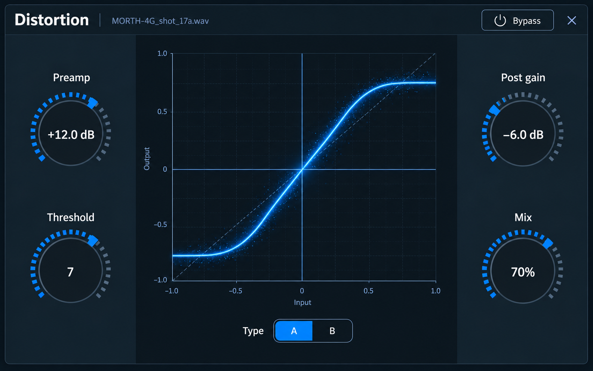

# Distortion visual concept

Requested 25 October 2026. Generated with the built-in imagegen tool using the
user-supplied Reverb image as the styling reference. The user approved this
concept for implementation on the same date. The native implementation and
actual captures are recorded in the [verification record](../../verification/distortion-redesign/README.md).

The four dials represent Preamp, Threshold (unitless 1–10), Post gain and Mix.
The center contains a conceptual transfer curve and the existing A/B type
selector. Values and curve geometry illustrate the design; implementation should
plot the exact existing DSP transfer. Bypass and the owner filename remain in
the header. No additional DSP controls are proposed.

The effect's shared display label is now Distortion. Serialized command/project
identifiers remain `fast_distortion`.

The complete generation prompt is in [mockup-prompt.txt](mockup-prompt.txt).

Rename validation: `cargo test --offline --test fast_distortion` passed both
existing reference/rendering and instance/history tests. `git diff --check`
passed. The generated image was visually inspected for labels and styling.
