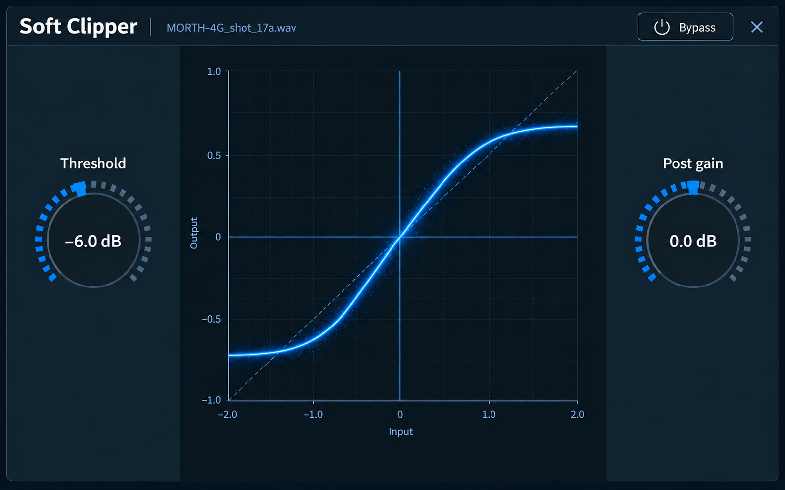
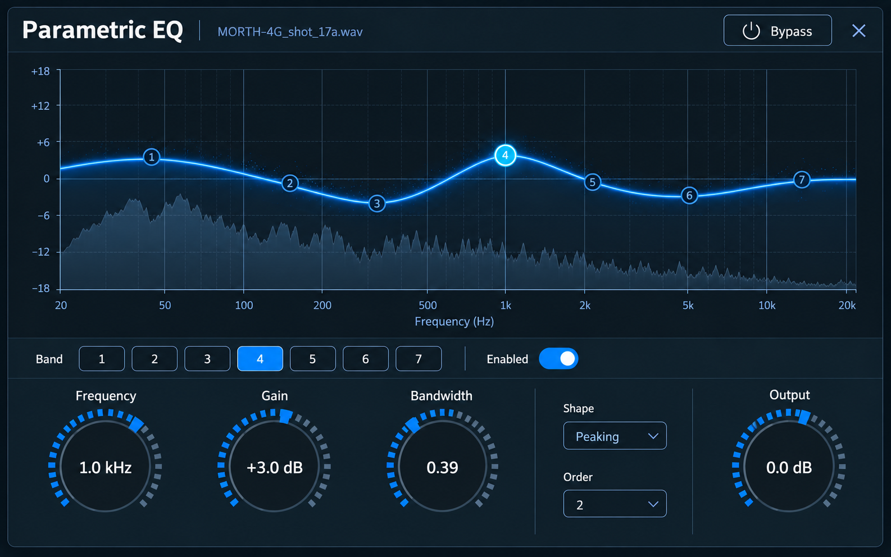
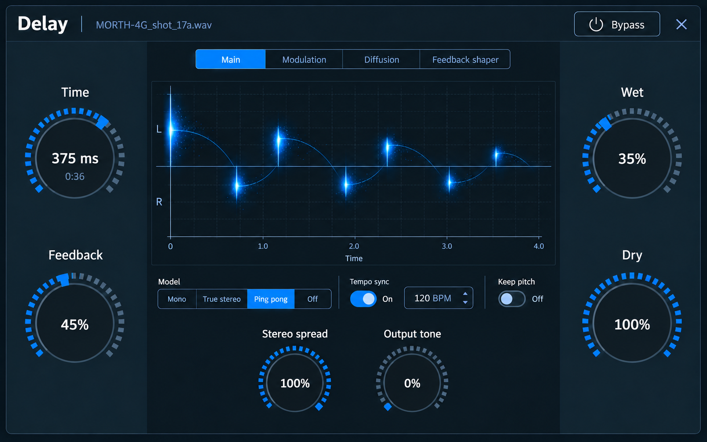
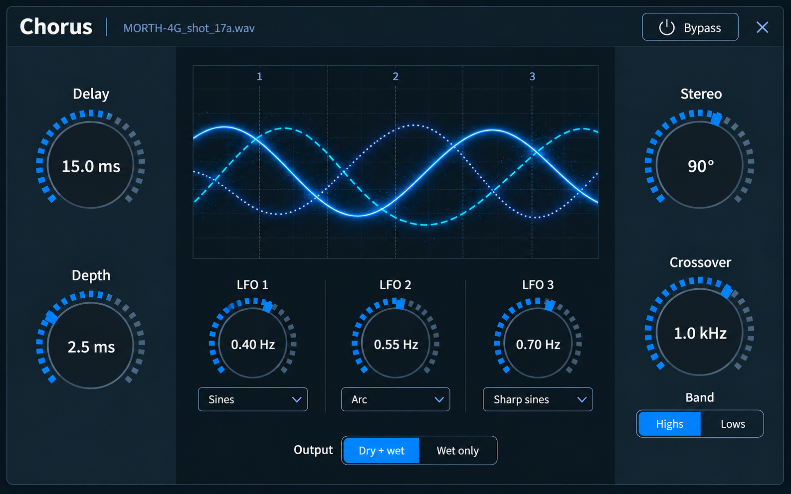
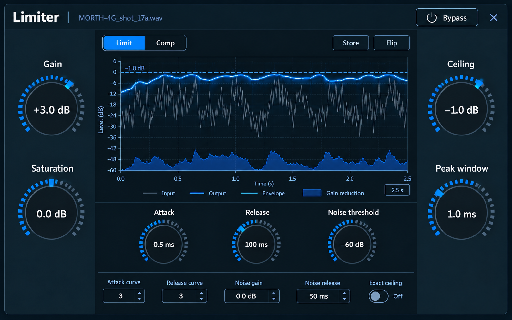
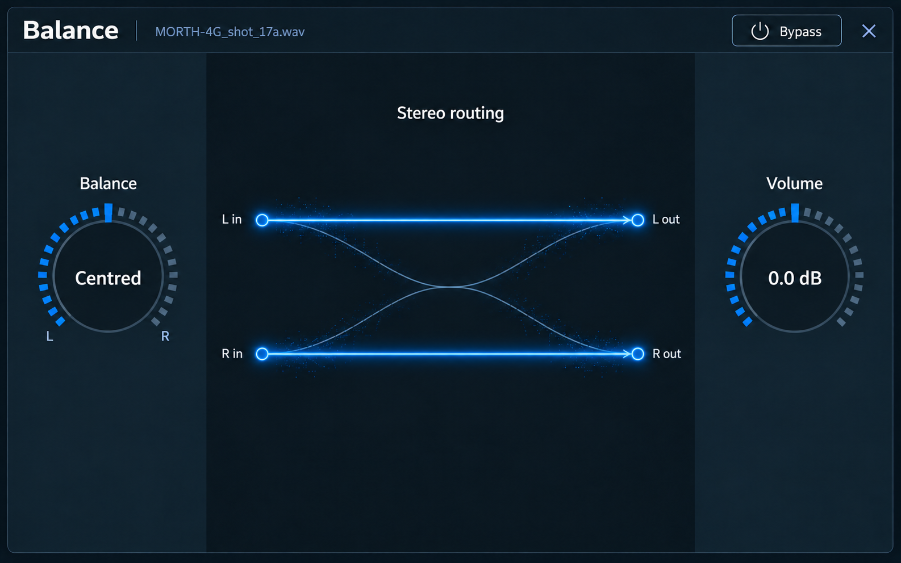
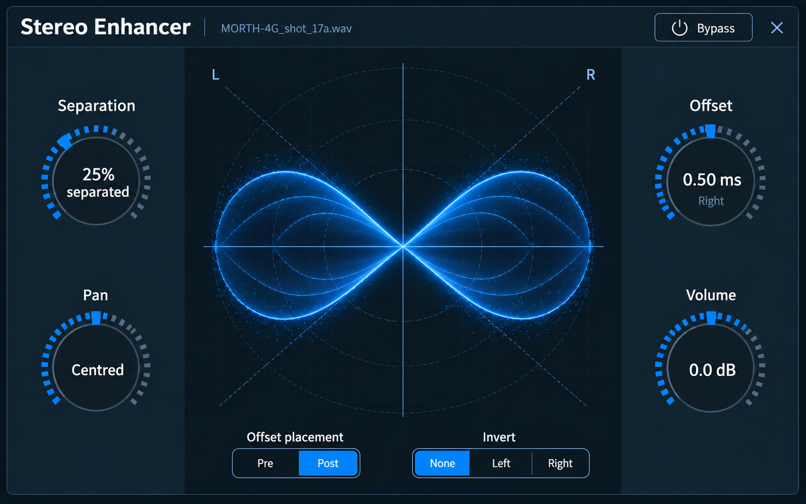
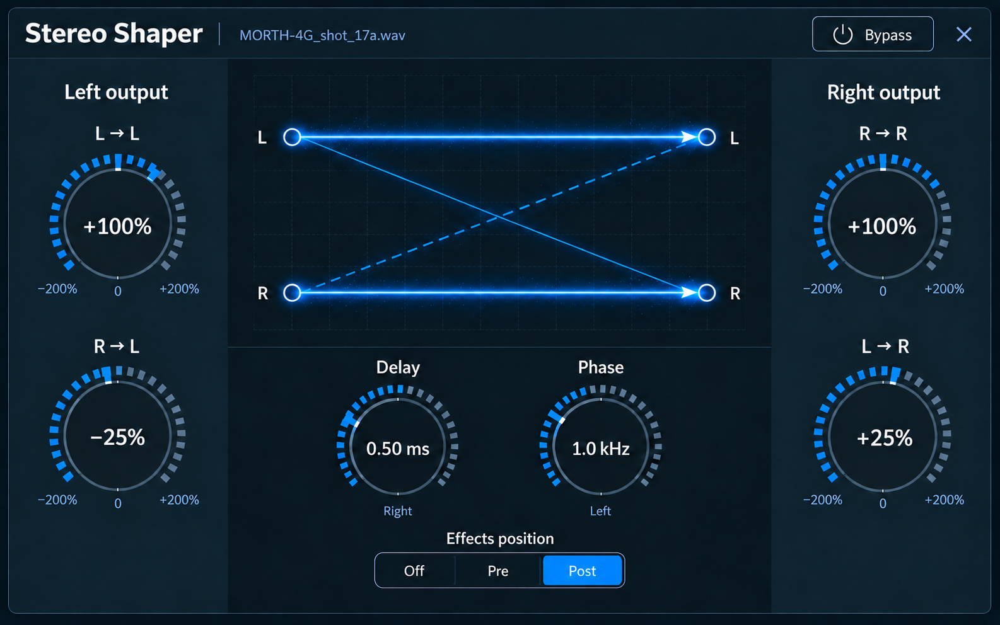
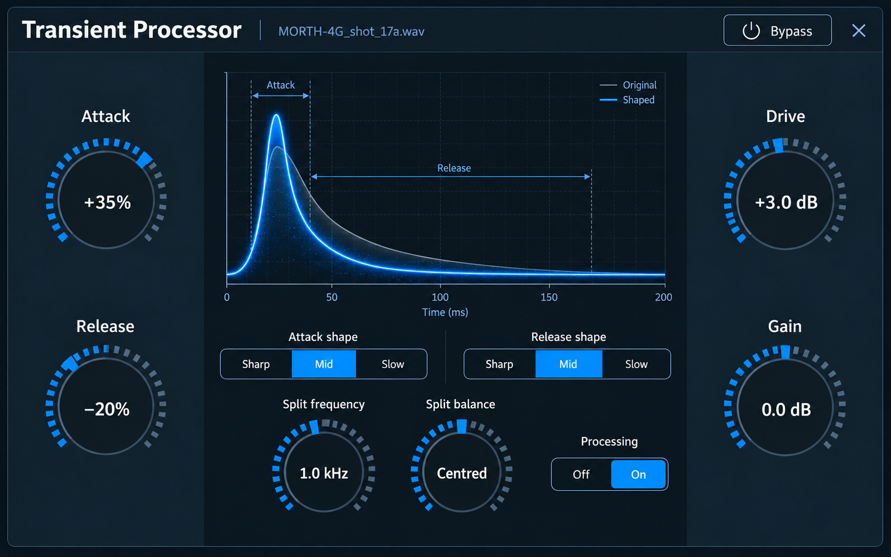

# Remaining effect-window concepts

Created 25 October 2026 at the user's request, using the built-in imagegen tool.
These nine visual concepts extend the approved [Reverb](../reverb/approved-six-dial.png)
and [Distortion](../distortion/distortion-mockup-v1.png) design family. The user
approved these visual targets for implementation tickets on 25 October 2026.
They are specified in [tickets 47–55](../../../.scratch/wavebob/README.md#effect-window-visual-refinements)
and the [shared acceptance contract](../../../.scratch/wavebob/effect-window-refinements.md).
The new tickets have not yet been implemented.

The common style is dark navy control banks, segmented blue dials, consistent
headers/Bypass controls, restrained typography and luminous blue effect-specific
visuals. Existing parameter metadata and editor controls were read before design.

| Effect | Concept | Generation prompt |
| --- | --- | --- |
| [Soft Clipper](soft-clipper-mockup-v1.png) | Two controls and a glowing soft-knee transfer. | [Prompt](soft-clipper-prompt.txt) |
| [Parametric EQ](parametric-eq-mockup-v1.png) | Seven-band graph, spectrum and selected-band controls. | [Prompt](parametric-eq-prompt.txt) |
| [Delay](delay-mockup-v1.png) | Main page with echo visualization and grouped advanced pages. | [Prompt](delay-prompt.txt) |
| [Chorus](chorus-mockup-v1.png) | Three modulation voices, seven dials, crossover and routing choices. | [Prompt](chorus-prompt.txt) |
| [Limiter](limiter-mockup-v1.png) | Limit/Comp pages with dynamics history and existing secondary controls. | [Prompt](limiter-prompt.txt) |
| [Balance](balance-mockup-v1.png) | Two controls with a folding stereo-routing illustration. | [Prompt](balance-prompt.txt) |
| [Stereo Enhancer](stereo-enhancer-mockup-v1.png) | Four dials, stereo-field illustration, placement and inversion. | [Prompt](stereo-enhancer-prompt.txt) |
| [Stereo Shaper](stereo-shaper-mockup-v1.png) | Signed stereo matrix, routing diagram and delay/all-pass controls. | [Prompt](stereo-shaper-prompt.txt) |
| [Transient Processor](transient-processor-mockup-v1.png) | Attack/release amounts, envelope illustration, split and output controls. | [Prompt](transient-processor-prompt.txt) |

## Interpretation for implementation

The pictures explore composition and appearance. Values, tick angles, graph
geometry and illustrative signals do not replace the existing reference laws,
ranges, units, defaults or actual DSP/telemetry. WaveBob must continue to draw
real transfers and response curves when appropriate. The stereo-field and
transient illustrations are settings illustrations, not proposed live analyzers.

Soft Clipper and Balance keep their actual two-control scope. Chorus retains
its Dry + wet / Wet only selector rather than inventing a Mix parameter.
Stereo Shaper's Phase is an all-pass corner frequency, not degrees. Transient
Processor's Attack/Release are shaping amounts, not time constants.

Delay shows the primary Main page. Its existing Input, R/L offset, Smoothing,
feedback filter/cutoff/resonance and remaining secondary controls must remain
reachable in secondary groups on Main and on the Modulation, Diffusion and
Feedback shaper pages; these additional states are not pictured. Limiter's
compressor controls remain on Comp. EQ band selection exposes all seven bands'
existing enable, frequency, gain, bandwidth, shape and order controls. The user
retained this EQ mockup and withdrew the proposed stacked-dial alternative:
horizontal node dragging edits frequency and Shift + vertical node dragging
edits bandwidth, with the visible selected-band controls kept in sync.
No DSP, command, source-code or executable changes are part of this publication.

## Gallery

### Soft Clipper

### Parametric EQ

### Delay

### Chorus

### Limiter

### Balance

### Stereo Enhancer

### Stereo Shaper

### Transient Processor

